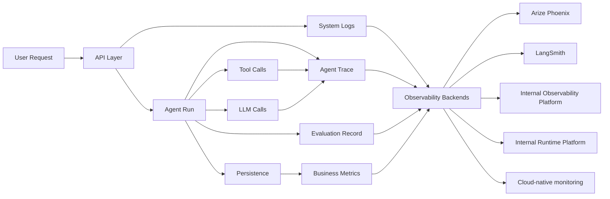

# Observability and Evaluation Architecture

> Status: draft design  
> Purpose: define how the platform should trace, measure, evaluate, and improve agentic AI behavior

---

## 1. Why observability is different for agentic AI

Traditional web observability answers:

- Is the API healthy?
- How long did requests take?
- Which errors occurred?
- Are infrastructure resources stable?

Agentic AI observability must answer more:

- Which agent was selected?
- What prompt version was used?
- Which tools did the model call?
- Did the retrieved evidence support the answer?
- Did the critic retry the workflow?
- Did the output require approval?
- Was the approval accepted or rejected?
- How many tokens and how much cost were consumed?
- Did the answer improve business outcomes?

For reusable agentic platforms, observability and evaluation are core product capabilities.

---

## 2. Four telemetry categories

| Category | Purpose | Examples |
|---|---|---|
| System telemetry | Operate the application | API latency, errors, uptime, connector health |
| Agent telemetry | Understand agent behavior | prompt, model, tool calls, trace spans, retries |
| Evaluation telemetry | Measure quality | grounding, relevance, correctness, safety, regression tests |
| Business telemetry | Measure impact | deflection, MTTR, approvals, hours saved, adoption |

All four are needed.

---

## 3. Target observability flow



---

## 4. Run envelope

Every agent execution should produce a normalized run envelope.

Conceptual schema:

```text
AgentRunEnvelope
├── run_id
├── trace_id
├── tenant_id
├── instance_id
├── thread_id
├── user_id
├── environment
├── request
│   ├── input_text
│   ├── channel
│   └── timestamp
├── routing
│   ├── intent
│   ├── selected_agents
│   └── routing_confidence
├── model
│   ├── provider
│   ├── model_name
│   ├── deployment_name
│   └── parameters
├── prompts
│   ├── prompt_pack_id
│   ├── prompt_versions
│   └── rendered_prompt_hashes
├── tool_calls
│   ├── tool_name
│   ├── arguments
│   ├── result_summary
│   ├── latency_ms
│   └── status
├── quality
│   ├── critic_score
│   ├── critic_feedback
│   ├── retry_count
│   └── grounding_score
├── approval
│   ├── required
│   ├── task_id
│   ├── decision
│   └── reviewer
├── usage
│   ├── prompt_tokens
│   ├── completion_tokens
│   ├── total_tokens
│   └── estimated_cost
├── output
│   ├── final_response
│   ├── citations
│   └── status
└── timings
    ├── started_at
    ├── ended_at
    └── duration_ms
```

Sensitive fields should be redacted before export based on policy.

---

## 5. Internal interfaces

Avoid hardwiring Phoenix, LangSmith, or internal enterprise platforms directly into business logic.

Introduce neutral interfaces.

### `RunObserver`

Responsible for lifecycle callbacks.

```text
RunObserver
├── on_run_start(context)
├── on_agent_start(agent_name, state)
├── on_llm_call_start(payload)
├── on_llm_call_end(result)
├── on_tool_call_start(tool_name, args)
├── on_tool_call_end(result)
├── on_policy_decision(decision)
├── on_approval_created(task)
├── on_run_end(envelope)
└── on_run_error(error)
```

### `TraceCollector`

Exports traces to a backend.

Implementations:

- `NoopTraceCollector`
- `PhoenixTraceCollector`
- `LangSmithTraceCollector`
- `InternalObservabilityTraceCollector`
- `InternalRuntimeTraceCollector`
- `OpenTelemetryTraceCollector`

### `EvalRecorder`

Stores online and offline evaluation records.

Implementations:

- local JSONL recorder
- database recorder
- Phoenix eval recorder
- LangSmith dataset/eval recorder
- internal platform integration recorder

---

## 6. Phoenix integration path

Arize Phoenix can be used for LLM observability and evaluation workflows.

Potential role:

- trace visualization
- prompt and response analysis
- retrieval diagnostics
- evaluation experiments
- model comparison

Recommended integration:

- implement `PhoenixTraceCollector`
- emit normalized run envelopes
- use OpenTelemetry-compatible spans where possible
- keep Phoenix optional through configuration
- avoid Phoenix-specific code in agents

Best fit:

- vendor-neutral LLM observability
- RAG diagnostics
- evaluation experimentation

---

## 7. LangSmith integration path

LangSmith is especially useful for LangChain/LangGraph-heavy applications.

Potential role:

- graph/chain trace debugging
- prompt iteration
- dataset-driven evaluation
- developer feedback loops

Recommended integration:

- implement `LangSmithTraceCollector`
- enable for development and selected test environments first
- use it for tracing LangGraph execution and evaluating routing/tool behavior
- avoid relying on LangSmith as the only source of production audit data

Best fit:

- developer debugging
- LangGraph trace inspection
- regression datasets

---

## 8. Internal platform integration

Because this is intended to support enterprise platform extensibility, internal runtime and observability platforms should be treated as first-class future integrations.

However, their final roles may vary. They could provide:

- model gateway
- agent runtime
- observability dashboards
- evaluation capabilities
- governance workflows
- knowledge integration
- deployment platform features

Recommended strategy:

- do not assume exactly what they provide yet
- create adapter seams for each likely capability
- allow internal platforms to plug into provider, observability, evaluation, policy, or deployment layers

Possible adapters:

```text
platform/providers/llm/internal_runtime.py
platform/providers/search/internal_knowledge.py
platform/providers/observability/internal_observability.py
platform/providers/observability/internal_runtime.py
platform/policy/adapters/internal_policy.py
platform/evaluation/adapters/internal_eval.py
```

This keeps the platform future-compatible without blocking current implementation.

---

## 9. Evaluation types

### Online evaluation

Runs during or immediately after real user interactions.

Examples:

- critic score
- grounding score
- citation presence
- safety classification
- user feedback
- approval decision outcome

### Offline evaluation

Runs against curated datasets.

Examples:

- known incident triage cases
- expected tool selection cases
- knowledge question-answer pairs
- RCA quality test cases
- safety and refusal cases

### Human evaluation

Performed by reviewers or domain experts.

Examples:

- answer helpfulness
- evidence quality
- operational correctness
- policy compliance

---

## 10. Evaluation dimensions

| Dimension | Description |
|---|---|
| Relevance | Did the answer address the user question? |
| Grounding | Was the answer supported by retrieved evidence? |
| Citation quality | Were citations specific and useful? |
| Tool correctness | Did the agent select the right tool? |
| Policy compliance | Did the response follow governance rules? |
| Safety | Did the response avoid unsafe or sensitive actions? |
| Completeness | Were required fields and steps included? |
| Actionability | Could a user act on the response? |
| Approval quality | Were approval-required actions correctly flagged? |

---

## 11. Minimum viable observability plan

Phase 1:

- add `run_id` and `trace_id`
- emit structured run envelopes
- add `RunObserver` interface
- implement `NoopTraceCollector`
- store run summaries in the domain store

Phase 2:

- add Phoenix or LangSmith adapter
- capture LLM calls and tool spans
- record token usage and model latency
- add basic evaluation datasets

Phase 3:

- add internal platform adapters when integration details are known
- add dashboarding for business metrics
- add automated regression gates in CI

---

## 12. Key rule

Do not make observability an afterthought attached only to logs.

For an agentic platform, observability should be designed into:

- orchestrator
- agent execution
- tool execution
- provider calls
- policy decisions
- approval workflow
- evaluation pipeline
