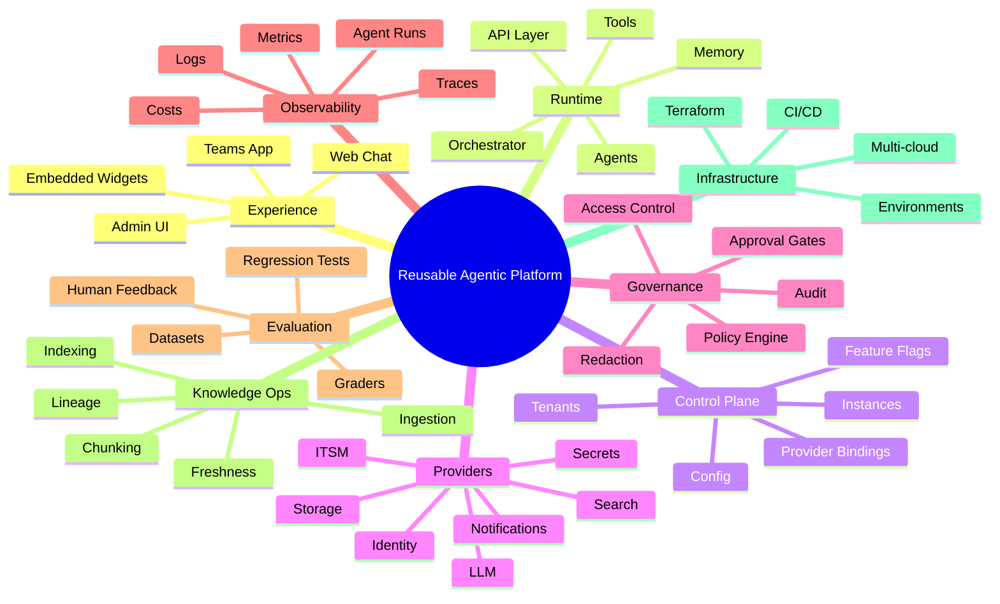

# Platform Components Inventory

> Status: draft inventory  
> Purpose: list the major components a reusable enterprise agentic AI platform should consider

---

## 1. Why this inventory matters

A beginner-friendly mistake is to think an agentic AI platform only needs agents, tools, and an LLM.

A production-grade reusable platform needs additional layers for configuration, safety, observability, evaluation, tenancy, infrastructure, and operations.

This document lists the major components so future repo design decisions can be evaluated comprehensively.

---

## 2. Component map

---

## 3. Runtime components

| Component | Purpose | Current status |
|---|---|---|
| API layer | Expose chat, thread, approval, health APIs | present |
| Orchestrator | Execute agent graph | present |
| Agents | Domain reasoning units | present |
| Tool registry | Function-callable tool dispatch | present |
| Connectors/providers | External system access | present as connectors, needs provider abstraction |
| Store | Persist domain and conversation state | present, needs tenancy |
| Memory/checkpointing | Persist graph state | present conceptually |

---

## 4. Platform components

| Component | Purpose | Priority |
|---|---|---|
| Tenant registry | Manage teams/tenants | high |
| Instance registry | Manage assistant instances | high |
| Provider registry | Bind capabilities to concrete providers | high |
| Prompt registry | Version and select prompts | high |
| Policy engine | Govern tools and side effects | high |
| Run observer | Capture execution traces | high |
| Eval recorder | Store online/offline quality records | medium-high |
| Feature flags | Gradual rollout by tenant/instance | medium |
| Admin APIs | Manage platform configuration | medium |
| Admin UI | Human-facing control plane | later |

---

## 5. Governance components

| Component | What it controls |
|---|---|
| Tool policy | Which tools can run |
| Approval policy | Which actions require HITL approval |
| Model policy | Which models are allowed |
| Data policy | What can be sent to LLMs or traces |
| Redaction policy | What must be masked |
| Retention policy | How long logs/traces/conversations are kept |
| Access policy | Which users can access tenants, approvals, admin settings |

---

## 6. Knowledge operations components

A reusable RAG assistant needs knowledge operations, not just search.

Components:

- source registry
- ingestion jobs
- document parser
- chunking strategy
- embedding generation
- index writer
- lineage tracking
- document freshness checks
- deletion/retention handling
- tenant-specific indexes or filters
- evaluation datasets from knowledge sources

This can be added after the runtime matures, but the architecture should leave room for it.

---

## 7. Operations components

| Component | Purpose |
|---|---|
| Health checks | Verify provider connectivity |
| Readiness checks | Verify app is ready for traffic |
| Runbooks | Human procedures for operations |
| Alerting | Notify operators of failures |
| Cost tracking | Monitor LLM/search usage |
| Deployment tracking | Know which version is deployed |
| Audit export | Export compliance evidence |
| Incident response | Operate the platform itself |

---

## 8. Recommended minimal platform core

The minimum reusable platform core should include:

1. tenant context
2. provider interfaces
3. prompt registry
4. tool registry
5. policy engine
6. run observer
7. store abstraction
8. evaluation foundation

Everything else can be layered gradually.

---

## 9. Internal extension points

Leave explicit seams for internal enterprise platforms:

- internal runtime platform as model/runtime/provider adapter
- internal observability platform as observability/search/evaluation adapter
- internal identity or secrets systems
- internal CI/CD and deployment controls
- internal governance and compliance tooling

The key is to treat these as adapters, not as hardcoded dependencies.
