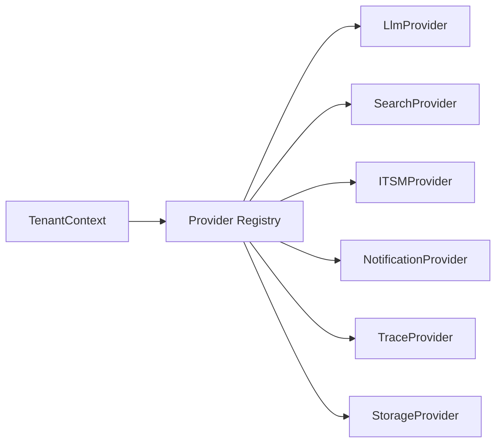

# Provider Abstraction Strategy

> Status: draft design  
> Purpose: define how the platform can support Azure now and other providers later without rewriting agents

---

## 1. Problem statement

The current implementation is Azure-first. That is practical and appropriate for the initial AI Operations Concierge.

However, a reusable platform should not permanently couple agents and business logic to one provider family.

The platform should be able to support:

- Azure OpenAI now
- Azure AI Search now
- Entra ID now
- Teams notifications now
- AWS, GCP, OpenAI, internal enterprise platforms, or other providers later

The way to achieve this is provider abstraction.

---

## 2. Core principle

Agents should depend on capabilities, not vendors.

Instead of agents knowing about Azure OpenAI or Azure AI Search, they should depend on logical capabilities:

- chat completion
- embedding
- hybrid search
- incident lookup
- notification sending
- trace recording
- secret retrieval
- identity validation

Concrete providers implement those capabilities.

---

## 3. Capability interfaces

Recommended top-level interfaces:

| Interface | Responsibility |
|---|---|
| `LlmProvider` | chat completion, structured generation, embeddings |
| `SearchProvider` | keyword/vector/hybrid retrieval |
| `ITSMProvider` | incident/problem/change/KA operations |
| `NotificationProvider` | Teams, email, Slack, webhooks |
| `IdentityProvider` | JWT validation and user profile resolution |
| `StorageProvider` | domain state, audit, settings, checkpoints |
| `SecretsProvider` | secret retrieval and rotation support |
| `TraceProvider` | traces, spans, run envelopes |
| `EvaluationProvider` | evaluation datasets, scores, reports |
| `PolicyProvider` | runtime policy decision support |

---

## 4. Provider registry

Use a registry to resolve concrete providers by tenant context.



Example provider binding:

```yaml
tenant_id: shared-enterprise
instance_id: ai-ops-dev
providers:
  llm:
    type: azure_openai
    config_ref: azure-openai-dev
  search:
    type: azure_ai_search
    config_ref: aiops-search-dev
  itsm:
    type: servicenow
    config_ref: servicenow-dev
  observability:
    type: phoenix
    config_ref: phoenix-dev
```

---

## 5. LLM provider abstraction

### Responsibilities

- chat completion
- structured output
- embedding
- model metadata
- token usage capture
- fallback behavior

### Possible implementations

| Provider | Implementation |
|---|---|
| Azure OpenAI | existing Azure OpenAI connector evolved into provider |
| OpenAI | direct OpenAI API |
| AWS Bedrock | Anthropic, Amazon Nova, or other Bedrock models |
| Google Vertex AI | Gemini and embedding models |
| Internal runtime platform | adapter if an internal platform provides model gateway/runtime |
| Local/mock | deterministic testing provider |

### Important design note

Do not expose raw vendor response objects to agents. Normalize responses into platform models.

---

## 6. Search provider abstraction

### Responsibilities

- keyword search
- vector search
- hybrid search
- document fetch
- citation metadata normalization

### Possible implementations

| Provider | Use case |
|---|---|
| Azure AI Search | current RAG store |
| OpenSearch | AWS-compatible search option |
| Vertex AI Search | GCP-compatible search option |
| Postgres pgvector | lightweight internal deployment |
| Internal knowledge platform | adapter if an internal platform provides knowledge/search services |
| In-memory | local fallback and tests |

---

## 7. Identity provider abstraction

Identity is often cloud-specific.

Possible implementations:

| Provider | Cloud/platform |
|---|---|
| Entra ID | Azure / Microsoft 365 / Teams |
| Cognito | AWS |
| Google Identity | GCP |
| OIDC generic | portable enterprise setup |
| Static/dev | local development only |

The application middleware should call an `IdentityProvider`, not directly implement one cloud identity strategy everywhere.

---

## 8. Observability provider abstraction

Possible implementations:

| Provider | Role |
|---|---|
| Noop | local/test default |
| OpenTelemetry | generic tracing bridge |
| Phoenix | LLM tracing and evaluation |
| LangSmith | LangGraph/LangChain tracing and datasets |
| Internal observability platform | organization-specific observability/evaluation integration if available |
| Internal runtime platform | organization-specific runtime/platform integration if available |
| Cloud-native | Azure Monitor, CloudWatch, Google Cloud Operations |

The observability provider should receive normalized run envelopes and spans.

---

## 9. Provider selection strategies

| Strategy | Description |
|---|---|
| Environment-level | one provider set per deployment |
| Tenant-level | provider set selected by tenant |
| Instance-level | provider set selected by assistant instance |
| Capability-level | different provider per capability |
| Dynamic routing | provider selected at runtime based on cost, latency, or policy |

Recommended progression:

1. environment-level first
2. instance-level second
3. dynamic routing only when maturity requires it

---

## 10. Fallback behavior

Fallbacks are useful, but they must be explicit.

Examples:

- LLM fallback to deterministic local response for tests
- search fallback to seeded KB snippets for demos
- notification fallback to audit log only
- ITSM fallback to in-memory records for local dev

Do not silently fallback in production for state-changing operations unless policy allows it.

---

## 11. Migration from current connectors

Current connector classes can be migrated gradually.

| Current connector | Target provider |
|---|---|
| `AzureOpenAIConnector` | `AzureOpenAILlmProvider` |
| `AzureSearchConnector` | `AzureAISearchProvider` |
| `ServiceNowConnector` | `ServiceNowITSMProvider` |
| `TeamsConnector` | `TeamsNotificationProvider` |
| telemetry tools | `TelemetryProvider` or domain tools backed by monitoring provider |

The existing connector layer is a good starting point. The main change is to define stable interfaces above the concrete implementations.

---

## 12. Anti-patterns to avoid

Avoid:

- importing Azure SDKs directly inside agents
- passing raw vendor clients into tools
- storing provider-specific response shapes in domain models
- hardcoding provider names in prompts
- assuming one identity provider globally forever
- mixing observability vendor code into business logic

---

## 13. Beginner-friendly mental model

Think of the platform as a universal power strip.

Agents and tools plug into standard sockets. Azure, AWS, GCP, internal enterprise platforms, Phoenix, or LangSmith are adapters that fit into those sockets.

The socket shape should stay stable even if the adapter changes.
