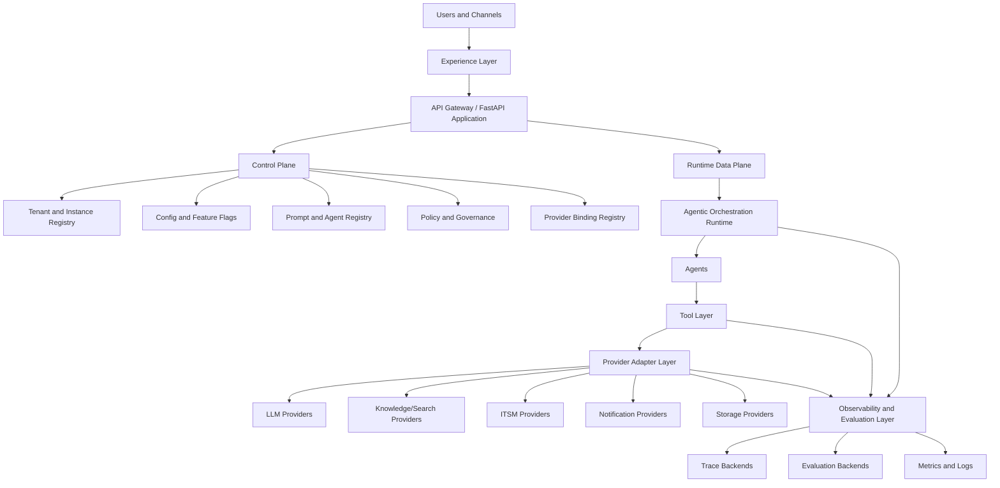
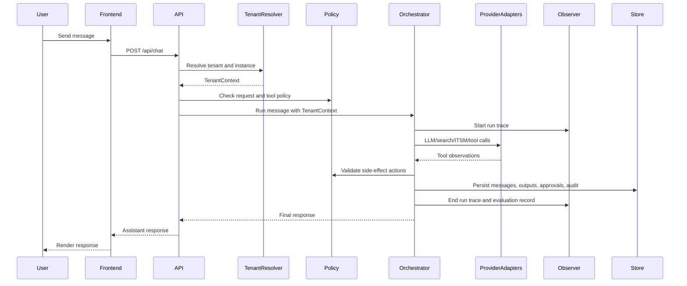

# Target Architecture — Reusable Agentic AI Platform

> Status: draft target architecture  
> Purpose: define the future-state platform model for reusable enterprise agentic assistants

---

## 1. Executive summary

The target platform is a reusable, tenant-aware, provider-agnostic source-code base for building enterprise agentic AI assistants.

It should support the current AI Operations Concierge use case while making it easier to create new assistant instances for other teams, domains, clients, or internal enterprise solutions.

The future platform should provide:

- a shared agentic orchestration runtime
- configurable agents, prompts, tools, and policies
- per-tenant or per-instance configuration
- pluggable provider adapters for LLM, search, identity, storage, notification, tracing, and evaluation
- observability and evaluation as first-class capabilities
- infrastructure patterns that can support Azure first, then AWS and GCP
- extension seams for internal runtime, search, observability, and future enterprise platforms

---

## 2. Current-state interpretation

The current implementation already has a good modular foundation:

- FastAPI routes expose the application API
- services coordinate chat, approval, dashboard, and orchestration
- agents implement domain behavior
- tools expose function-callable capabilities
- connectors isolate external systems
- store abstracts persistence
- middleware handles cross-cutting HTTP behavior

This is a strong application architecture. The target platform architecture keeps this pattern, but adds missing platform layers.

---

## 3. Target architecture layers

---

## 4. Control plane vs data plane

### Control plane

The control plane manages platform configuration and governance.

Responsibilities:

- define tenants and assistant instances
- bind tenants to providers and connector credentials
- manage prompt packs and agent manifests
- manage feature flags
- manage policies and approval rules
- manage observability and evaluation backends
- manage deployment profiles

The control plane should not execute business workflows directly. It tells the runtime how to behave.

### Data plane

The data plane executes user requests.

Responsibilities:

- authenticate requests
- resolve tenant/instance context
- run the agentic graph
- invoke tools and connectors
- enforce policy at runtime
- emit traces and evaluation records
- persist conversation, approvals, audit, and domain records

---

## 5. Request lifecycle in the target architecture

---

## 6. Platform components

### 6.1 Experience layer

Includes:

- React chat application
- Teams personal tab
- future admin/control-plane UI
- possible embedded widgets or API clients

The experience layer should not hardcode one backend deployment. It should be able to receive runtime config such as instance name, branding, enabled features, and auth mode.

### 6.2 API layer

Includes:

- public chat endpoints
- thread and run endpoints
- approval endpoints
- settings endpoints
- admin/control-plane endpoints
- health/readiness endpoints

The API should be thin. It should resolve context, call services, and return typed responses.

### 6.3 Tenant and instance layer

Introduces a `TenantContext` or `InstanceContext` passed through services, orchestrator, tools, and stores.

This layer decides:

- which tenant is making the request
- which assistant instance is active
- which providers are bound
- which policies apply
- which prompt pack applies
- which data partition should be used

### 6.4 Orchestration runtime

The orchestration runtime remains the core agentic layer.

Responsibilities:

- graph construction and execution
- agent routing
- tool invocation
- critic/quality gate
- human approval interruption/resume
- state management

It should depend on interfaces rather than concrete Azure or organization-specific implementations.

### 6.5 Agent and prompt registry

Agents should be registered declaratively.

The platform should eventually support:

- agent manifests
- prompt versions
- tool permissions per agent
- model preferences per agent
- tenant-specific overrides
- evaluation datasets per agent

### 6.6 Tool layer

Tools remain the bridge between agent reasoning and external action.

Target requirements:

- typed schemas
- policy-aware execution
- trace-aware execution
- tenant-aware connector resolution
- read/write classification
- approval requirement metadata

### 6.7 Provider adapter layer

Provider adapters hide cloud/vendor/platform specifics.

Examples:

- Azure OpenAI adapter
- OpenAI adapter
- AWS Bedrock adapter
- Google Vertex AI adapter
- Azure AI Search adapter
- OpenSearch adapter
- ServiceNow adapter
- Teams adapter
- internal knowledge-platform adapter
- internal runtime-platform adapter

### 6.8 Policy and governance layer

The policy layer determines what the agent is allowed to do.

Examples:

- which tools are enabled
- which write actions require approval
- whether a tenant can use a model
- whether an output must be redacted
- whether a low-confidence response should escalate
- whether a connector can write to production

### 6.9 Observability and evaluation layer

This layer captures what happened and how well it worked.

It should support:

- request logs
- distributed traces
- agent run traces
- tool call spans
- LLM spans
- token and cost metrics
- quality evaluations
- human feedback
- business outcome metrics

Backends should be pluggable.

### 6.10 Async jobs and eventing

Some platform tasks should not run inline with chat requests.

Examples:

- knowledge ingestion
- offline evaluations
- scheduled governance reports
- approval reminders
- webhook dispatch
- long-running RCA generation
- audit export

The platform should start with simple background tasks and allow migration to queues or event buses later.

---

## 7. Design principles

1. Prefer interfaces over concrete vendor dependencies.
2. Keep orchestration logic separate from provider implementation.
3. Resolve tenant context once and pass it explicitly.
4. Make policy enforcement explicit and auditable.
5. Treat observability and evaluation as product features, not afterthoughts.
6. Keep prompts versioned and externalized.
7. Keep current Azure-first behavior as an adapter, not as the platform assumption.
8. Design for gradual migration, not a rewrite.

---

## 8. Relationship to reusable agentic frameworks

The target platform is similar in spirit to an agentic framework because it aims to provide reusable primitives for building AI agents and workflows.

However, it is more application-platform-oriented than framework-only. It includes:

- frontend experience patterns
- approval workflows
- tenant management
- observability/evaluation integration
- infra deployment conventions
- enterprise connector patterns

A useful framing is:

> Reusable agentic framework: reusable agentic workflow foundation.  
> This target platform: reusable enterprise assistant product foundation built around an agentic workflow core.

---

## 9. Target maturity levels

| Level | Description |
|---|---|
| Level 0 | Single-purpose POC application |
| Level 1 | Modular application with connectors and store abstraction |
| Level 2 | Configurable multi-instance source base |
| Level 3 | Tenant-aware runtime with policy, observability, and provider adapters |
| Level 4 | Self-service internal platform with admin UI and automated deployments |
| Level 5 | Multi-cloud, multi-provider enterprise agentic platform |

The current implementation is approximately between Level 1 and early Level 2. The proposed architecture targets Level 3 first, then Level 4.
