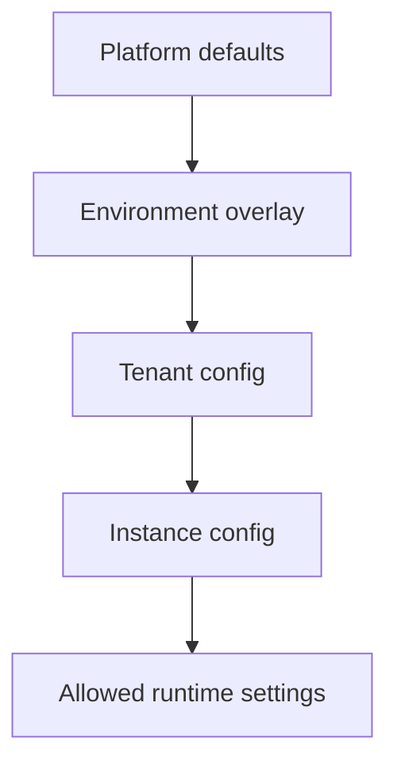

# Tenancy and Control Plane

> Status: draft design  
> Purpose: define how the platform can support reusable tenant/team/instance-based assistants

---

## 1. Why this layer is needed

The current implementation is mostly single-instance. It loads one application configuration at startup and creates one set of connectors, one store, and one orchestrator.

That is appropriate for a POC, but a reusable platform needs a way to answer these questions per request:

- Which team or tenant is this user from?
- Which assistant instance should handle this request?
- Which provider configuration should be used?
- Which prompt pack should be used?
- Which tools are allowed?
- Which policies apply?
- Where should data be stored?
- Which observability backend should receive traces?

That is the role of the tenancy and control-plane layer.

---

## 2. Terminology

| Term | Meaning |
|---|---|
| Tenant | A logical organization, team, client, or business unit using the platform |
| Instance | A configured assistant deployment or runtime profile under a tenant |
| Environment | Runtime environment such as local, dev, test, or prod |
| Provider binding | Mapping from logical capability to concrete backend, such as Azure OpenAI for LLM |
| Prompt pack | Versioned group of prompts used by an assistant instance |
| Policy profile | Rules that control tool use, approvals, models, and safety |
| Control plane | Management/configuration layer |
| Data plane | Runtime request execution layer |

---

## 3. Tenant vs instance

A tenant may have multiple assistant instances.

Example:

```text
Tenant: Shared Enterprise
├── Instance: ai-ops-dev
├── Instance: ai-ops-prod
├── Instance: hr-support-poc
└── Instance: cloud-cost-analyst
```

Each instance can have different:

- prompts
- tools
- connectors
- knowledge indexes
- policies
- observability settings
- storage partitions
- deployment profile

---

## 4. Target `TenantContext`

Every runtime request should be enriched with a context object.

Conceptual fields:

```text
TenantContext
├── tenant_id
├── instance_id
├── environment
├── user
├── roles
├── provider_bindings
├── prompt_pack_id
├── policy_profile_id
├── feature_flags
├── data_partition
├── trace_config
└── request_metadata
```

This context should be passed to:

- chat service
- orchestrator
- agents
- tool executor
- connector/provider resolver
- store
- policy engine
- observability layer

---

## 5. Tenant resolution strategies

The platform can support multiple strategies.

| Strategy | Description | Best for |
|---|---|---|
| Hostname-based | `team-a.assistant.company.com` maps to tenant | production SaaS-like deployments |
| Path-based | `/t/{tenant_id}/api/chat` | shared backend, explicit routing |
| Header-based | `X-Tenant-Id` | internal APIs and controlled clients |
| Token-claim-based | tenant derived from JWT claim | enterprise SSO |
| Deployment-based | one deployment per tenant | simpler early-stage model |

Recommended early approach:

1. deployment-based or environment-based for initial simplicity
2. token/header-based for internal multi-tenant runtime
3. hostname-based later if building self-service product experience

---

## 6. Control-plane responsibilities

The control plane should manage metadata, not run agent workflows.

Responsibilities:

- tenant registry
- instance registry
- provider binding registry
- prompt pack registry
- policy profile registry
- feature flags
- secrets references
- deployment profiles
- observability backend selection
- admin audit log

---

## 7. Data model sketch

### Tenant

```text
Tenant
├── tenant_id
├── display_name
├── status
├── owner_group
├── allowed_domains
├── default_environment
├── created_at
└── updated_at
```

### AssistantInstance

```text
AssistantInstance
├── instance_id
├── tenant_id
├── display_name
├── solution_type
├── environment
├── prompt_pack_id
├── policy_profile_id
├── provider_profile_id
├── storage_profile_id
├── observability_profile_id
├── enabled_features
├── status
└── version
```

### ProviderProfile

```text
ProviderProfile
├── provider_profile_id
├── llm_provider
├── search_provider
├── identity_provider
├── notification_provider
├── storage_provider
├── secrets_provider
└── observability_provider
```

---

## 8. Config inheritance

Use layered configuration.



Example:

- platform default says approval-first is enabled
- environment overlay says dev can use fallback connectors
- tenant config says use tenant-specific branding
- instance config says use AI Ops prompt pack
- runtime setting says default temperature is 0.4

---

## 9. Isolation requirements

### Data isolation

All persisted data should include `tenant_id` and ideally `instance_id`.

Applies to:

- threads
- messages
- approvals
- agent outputs
- audit logs
- dashboard snapshots
- runtime settings
- evaluation records

### Connector isolation

Provider credentials should be scoped by tenant or instance.

Examples:

- one ServiceNow instance per tenant
- one search index per assistant instance
- one Teams webhook per approval group
- one tracing project per environment

### Approval isolation

Approval queues should be scoped.

An approver for one tenant should not see or decide approval tasks for another tenant unless explicitly granted cross-tenant admin rights.

---

## 10. Feature flags

Feature flags are needed for gradual rollout.

Examples:

- `knowledge_search_enabled`
- `incident_creation_enabled`
- `servicenow_write_enabled`
- `teams_notifications_enabled`
- `langsmith_tracing_enabled`
- `phoenix_tracing_enabled`
- `offline_eval_enabled`
- `experimental_agent_routing_enabled`

Feature flags should be resolved through `TenantContext`.

---

## 11. Admin/control-plane UI

A future admin UI can manage:

- tenant creation
- instance setup
- prompt pack assignment
- provider binding
- policy profiles
- feature flags
- observability backends
- health checks
- deployment status

This should be separate from the user-facing chat UI.

---

## 12. Minimal viable implementation

A pragmatic first version can be simple:

1. Add `tenant_id` and `instance_id` to config.
2. Add `TenantContext` model.
3. Add a `TenantResolver` dependency.
4. Add tenant fields to persisted models.
5. Pass context through services and orchestrator.
6. Keep one deployment per tenant initially.
7. Introduce dynamic provider resolution later.

This avoids overengineering while keeping the future path open.
